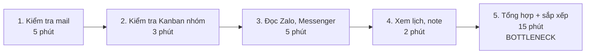
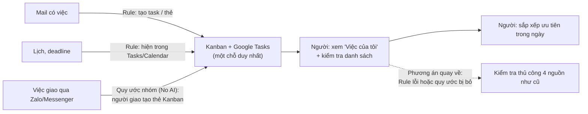

# Báo cáo nhóm — Day 02 Discovery & Problem Framing

> Bản chung của nhóm, viết trên repo do nhóm trưởng fork. Không copy file này sang repo cá nhân.
> Template chi tiết và prompt mẫu: [docs/01-worksheet.md](../../docs/01-worksheet.md). Bài mẫu: [docs/02-deliverable-example.md](../../docs/02-deliverable-example.md).

## 1. Thông tin nhóm

- Tên nhóm: L3A5AE
- Thành viên: xem `TEAM.md`
- Candidate problem được chọn (1 câu): Mỗi sáng, người làm việc nhóm mất khoảng 30 phút để gom việc và deadline từ 4 nguồn (mail, Kanban nhóm, Zalo/Messenger, lịch) mà vẫn bỏ lỡ khoảng 10 việc mỗi tháng.
- Quyết định cuối: **Go, phạm vi nhỏ** (Rule + quy ước nhóm, không dùng AI ở giai đoạn này)

---

## 2. Hội tụ nhóm (CP3)

### 2.1. Pitch

| # | Người đưa ra | Candidate (Job Story ngắn) | Actor | Bottleneck | Câu hỏi phản biện nhận được (ai hỏi) |
|---:|---|---|---|---|---|
| 1 | | | | | |
| 2 | | | | | |
| 3 | | | | | |
| 4 | | | | | |
| 5 | | | | | |
| 6 | | | | | |
| 7 | | | | | |
| 8 | | | | | |
| 9 | | | | | |
| 10 | | | | | |
| 11 | | | | | |
| 12 | | | | | |

### 2.2. Cluster

| Cluster | Các candidate | Pattern chung |
|---|---|---|
| A | | |
| B | | |
| C | | |

### 2.3. Opportunity Solution Tree rút gọn

Gốc là **1 outcome**. Nhánh là **opportunity** (nhu cầu, pain), không phải tính năng hay công cụ.

```text
OUTCOME: 
├── Opportunity A: 
├── Opportunity B: 
└── Opportunity C: 
```

Những ý đã gạch bỏ vì là solution đội lốt opportunity:

-

### 2.4. Chấm điểm shortlist (1–5)

| Candidate | Actor rõ | Quy trình rõ | Pain có bằng chứng | Impact đo được | Vừa sức lab | So sánh được No AI/Rule/Workflow/Agent | Nhóm hiểu domain | Tổng |
|---|---:|---:|---:|---:|---:|---:|---:|---:|
| | | | | | | | | |
| | | | | | | | | |
| | | | | | | | | |

**Candidate được chọn:**

**Vì sao chọn:**

**Vì sao loại các candidate còn lại:**

**Xử lý bất đồng (nếu có):**

---

## 3. Kiểm chứng + research giải pháp đã có (CP4)

### 3.1. Assumption Map

| # | Giả định | Loại (Value / Usability / Feasibility / Viability) | Quan trọng (1–5) | Đã có bằng chứng (1–5) | Kiểm chứng trước? |
|---:|---|---|---:|---:|---|
| 1 | Việc bị lỡ chủ yếu do việc nằm rải rác ở nhiều nguồn (đặc biệt là việc được giao qua tin nhắn), không phải do quên xem hay ưu tiên sai | Value | 5 | 1 | **Có** |
| 2 | Người dùng thật sự thiếu thời gian: mất từ 20 phút mỗi sáng để gom việc, không phải "thừa thời gian" | Value | 5 | 2 | **Có** |
| 3 | Người dùng chưa có trợ lý hay công cụ nào gom việc hộ (nếu đã có thì bài toán đã được giải) | Value | 4 | 2 | **Có** |
| 4 | Các nguồn thông tin (mail, lịch, Kanban, Zalo/Messenger) cho phép lấy dữ liệu ra tự động | Feasibility | 4 | 3 | Kiểm bằng research |
| 5 | Người dùng chấp nhận cho một công cụ truy cập thông tin cá nhân (mail, tin nhắn) | Viability | 4 | 1 | Có, hỏi trong phỏng vấn |
| 6 | Người dùng tiếp cận và dùng được công cụ công nghệ (app task, Kanban, tự động hóa) | Usability | 3 | 4 | Không (cả nhóm đang dùng Kanban và mail hằng ngày) |

Giả định nhóm kiểm chứng trong buổi này: **#1, #2, #3** bằng phỏng vấn; **#4** bằng research; **#5** bằng một câu hỏi phụ cuối buổi phỏng vấn.

### 3.2. Kiểm chứng

Cách đã dùng: Phỏng vấn 2 người ngoài nhóm qua tin nhắn (chat), ngày 09/11/2026, theo các câu hỏi trong kịch bản dùng chung

Kịch bản phỏng vấn dùng chung: [report/assets/cp4-interview-script.md](../assets/cp4-interview-script.md)

**Interview Snapshot #1**

| Trường | Nội dung |
|---|---|
| Người được hỏi (vai trò, không ghi tên thật) | Người đi làm, nhận việc từ sếp qua Zalo và từ các nhóm chat Facebook |
| Câu nói đáng nhớ nhất (nguyên văn) | "Gmail thì không mất nhưng trong ib fb thì lỡ nhiều lắm, nhất là trong mấy group hay trôi tin nhắn, xong toàn bị ăn chửi thôi." |
| Lần gần nhất gặp vấn đề này: chuyện gì đã xảy ra? | Lỡ deadline thường xuyên; việc bị lỡ chủ yếu nằm trong tin nhắn Facebook, nhất là các group bị trôi tin; hậu quả là bị trách |
| Hiện đang xử lý bằng cách nào (workaround)? | Mỗi sáng mở mail → Zalo → Facebook → Kanban, rồi điền việc vào Kanban. Ghi giấy nhớ; việc sếp giao qua Zalo thì ghi ngay vào giấy nhớ. Nhiều việc quên không ghi lại nên quên hẳn |
| Mất bao lâu, bao lần? | Khoảng 20 phút mỗi sáng; lỡ khoảng 10 việc mỗi tháng |
| Insight / opportunity rút ra | Nguồn gây lỡ việc là **tin nhắn trôi trong group chat**, không phải mail. Điểm hỏng là **bước ghi lại**: việc không được ghi ngay khi đọc thì mất hẳn |

**Interview Snapshot #2**

| Trường | Nội dung |
|---|---|
| Người được hỏi (vai trò, không ghi tên thật) | Người đi làm trong một team giao việc hoàn toàn trên Kanban |
| Câu nói đáng nhớ nhất (nguyên văn) | "Giao việc bằng zalo là bơ luôn, không chat công việc zalo." |
| Lần gần nhất gặp vấn đề này: chuyện gì đã xảy ra? | Quên một việc ngay sáng hôm phỏng vấn, sửa kịp nên không có hậu quả. Việc bị lỡ chủ yếu nằm trong Gmail, vì mail bị trôi, xem lại khó nên quên |
| Hiện đang xử lý bằng cách nào (workaround)? | Mỗi sáng mở Google Calendar và Kanban. Ghi việc bằng Notepad trên laptop, mở lại là thấy; vẫn đang dùng. Team quy định không giao việc qua Zalo |
| Mất bao lâu, bao lần? | Khoảng 10 phút mỗi sáng; lỡ khoảng 3–4 việc mỗi tháng |
| Insight / opportunity rút ra | Team có quy ước **mọi việc nằm trên Kanban** thì thời gian buổi sáng thấp hơn (10 phút so với 20–30 phút) và lỡ ít việc hơn (3–4 so với ~10). Phần còn lỡ đến từ **mail bị trôi**: đúng phần Rule mail → task giải được |

Tổng hợp:

| Nguồn | Số người / số mẫu | Tín hiệu xác nhận | Tín hiệu phản bác |
|---|---:|---|---|
| Phỏng vấn | 2 | Cả 2 người đều lỡ việc hằng tháng (khoảng 10 và 3–4 việc). Người 1 mất khoảng 20 phút mỗi sáng, lỡ việc chủ yếu từ tin nhắn group chat, không có công cụ nào ngoài giấy nhớ (xác nhận giả định #1, #3) | Người 2 chỉ mất 10 phút mỗi sáng, dưới ngưỡng 20 phút của giả định #2. Người 2 lỡ việc chủ yếu từ **Gmail**, không phải từ chat (phản bác một phần giả định #1). Người 2 hài lòng với Notepad và vẫn dùng (giả định #3 không đúng với mọi người) |
| Dữ liệu tự đo của nhóm (thẻ Problem Card #1 của Minh) | 1 | Khoảng 30 phút mỗi sáng; gần 10 việc bị lỡ trong tháng; 4 thành viên nhóm bị ảnh hưởng khi trễ việc | Mới có số liệu từ 1 người |

**Nhóm đã sửa problem thế nào sau kiểm chứng:**

Sau phỏng vấn, nhóm sửa 4 điểm:

1. **Thu hẹp bottleneck** từ "tổng hợp từ 4 nguồn" về **"việc đến từ tin nhắn (Zalo, Messenger, group Facebook) không được ghi ngay vào nơi chung"**. Người 1 lỡ việc chủ yếu vì tin nhắn trôi trong group và quên ghi lại.
2. **Mở rộng nguồn tin nhắn** thêm **group chat Facebook**. Trước đó nhóm chỉ tính Zalo và Messenger cá nhân.
3. **Không coi mail là đã giải xong.** Người 2 vẫn lỡ việc vì mail bị trôi, nên bước Rule mail → task là cần thiết chứ không chỉ "có thì tốt".
4. **Có bằng chứng cho hướng quy ước nhóm (No AI).** Team của người 2 quy định mọi việc nằm trên Kanban, và họ mất ít thời gian hơn, lỡ ít việc hơn. Đồng thời ghi nhận rủi ro: việc do **người ngoài nhóm** (ví dụ sếp của người 1) giao qua Zalo thì quy ước nhóm không bắt được, người nhận phải tự tạo thẻ ngay khi đọc.

Giả định #5 (người dùng chấp nhận cho công cụ đọc thông tin cá nhân) chưa được hỏi trong 2 buổi phỏng vấn này.

Sau research (mục 3.3), nhóm đã sửa một điểm: phần mail và lịch **đã có công cụ sẵn** giải được bằng Rule, nên nhóm thu hẹp khoảng trống cần giải về **việc được giao qua tin nhắn cá nhân (Zalo/Messenger)**.

### 3.3. Research giải pháp đã có

| Công cụ / case / pattern | Link | Giải bước nào trong quy trình? | Điểm mạnh | Khoảng trống / rủi ro | Bài học cho nhóm |
|---|---|---|---|---|---|
| Google Tasks (trong Gmail, Calendar, Chat) | https://support.google.com/tasks/answer/7675772 | Bước 1 (mail) và bước 4 (lịch): tạo task trực tiếp từ Gmail, Calendar và Chat; đặt ngày đến hạn và nhận thông báo | Có sẵn, miễn phí với tài khoản Google; đồng bộ nhiều thiết bị | Không gom được việc từ Zalo/Messenger; tài khoản tổ chức có thể bị admin tắt Tasks | Phần mail và lịch đã giải được bằng Rule, không cần AI |
| Trello: tạo thẻ bằng email (Email-to-board) | https://support.atlassian.com/trello/docs/creating-cards-by-email/ | Bước 1 → bước 2: gửi mail tới địa chỉ riêng của board để tạo thẻ (tiêu đề mail thành tên thẻ, thêm nhãn và thành viên qua tiêu đề) | Đưa việc từ mail vào thẳng Kanban nhóm, cả nhóm cùng thấy | Phải chủ động gửi hoặc chuyển tiếp mail; không xử lý được tin nhắn chat | Nối mail với Kanban bằng Rule; Kanban có thể là "một chỗ duy nhất" |
| Pancake (quản lý hội thoại đa kênh) | https://pancake.vn | Gom tin nhắn từ nhiều kênh về một giao diện | Gom hội thoại nhiều kênh vào một chỗ | Dành cho doanh nghiệp quản lý tin nhắn khách hàng (trang chủ nêu WhatsApp; Messenger ghi "sắp ra mắt"), không dành cho chat cá nhân hay nhóm học/làm việc; không quản lý deadline | Thị trường đã có công cụ gom tin nhắn, nhưng **không phục vụ chat cá nhân**: đây là khoảng trống thật, cũng là phần khó truy cập nhất |

---

## 4. Quy trình trước/sau (CP5)

### 4.1. Quy trình hiện tại



| Bước | Actor | Input | Output | Thời gian / tần suất | Ghi chú |
|---:|---|---|---|---|---|
| 1 | Thành viên nhóm (người tự gom việc) | Hộp thư | Các việc, deadline đến từ mail | 5 phút, mỗi sáng | Bước 1–4 cộng lại khoảng 15 phút |
| 2 | Thành viên nhóm | Kanban nhóm | Các thẻ việc đang giao cho mình | 3 phút, mỗi sáng | |
| 3 | Thành viên nhóm | Tin nhắn Zalo, Messenger (nhóm và cá nhân) | Các việc được giao qua chat | 5 phút, mỗi sáng | Việc giao qua chat không nằm trên Kanban, dễ bị trôi tin nhắn |
| 4 | Thành viên nhóm | Lịch, note cá nhân | Lịch họp, deadline đã ghi | 2 phút, mỗi sáng | |
| 5 | Thành viên nhóm | Kết quả bước 1–4 | Danh sách việc hôm nay đã sắp xếp | 15 phút, mỗi sáng | Dễ bỏ sót; tổng cả quy trình khoảng 30 phút mỗi sáng |

**Bottleneck chính:** Bước 5, tổng hợp và sắp xếp việc từ 4 nguồn rời rạc (khoảng 15 phút mỗi sáng). Đây là bước gây ra việc bị lỡ, vì những việc chỉ nằm trong tin nhắn (bước 3) không có ở nơi chung nào để đối chiếu.

### 4.2. Quy trình tương lai



| Bước | Ai/cái gì xử lý | Mô tả |
|---:|---|---|
| 1 | **Rule** | Mail có việc được gắn nhãn hoặc chuyển tiếp tới địa chỉ Email-to-board của Trello, tự tạo thẻ trên Kanban; hoặc tạo task trực tiếp từ Gmail trong Google Tasks, có ngày đến hạn |
| 2 | **Rule** | Deadline có trong Google Tasks/Calendar tự gửi thông báo |
| 3 | **Con người (quy ước nhóm, No AI)** | Việc giao qua Zalo/Messenger: người giao phải tạo thẻ Kanban (hoặc người nhận tự tạo ngay khi đọc); chat chỉ dùng để thảo luận |
| 4 | **Con người (kiểm tra)** | Mỗi sáng mở một màn hình "Việc của tôi" trên Kanban/Tasks, kiểm tra danh sách; quét nhanh Zalo một lần để bắt việc lọt quy ước |
| 5 | **Con người** | Sắp xếp ưu tiên và khung giờ trong ngày |

**Boundary:** Không có bước nào dùng AI. Rule chỉ được **tạo** thẻ hoặc task, không được tự xóa, tự đóng, tự đổi deadline hay tự giao việc cho người khác. Thứ tự ưu tiên trong ngày luôn do con người quyết định.

**Phương án quay về:** Nếu Rule lỗi (mail không thành thẻ) hoặc quy ước bị bỏ (việc vẫn giao qua chat), người dùng quay về kiểm tra thủ công 4 nguồn như quy trình hiện tại. Cuối mỗi tuần, nhóm đếm số việc bị lọt để quyết định có giữ quy trình mới không.

### 4.3. Before / after

| Chỉ số | Trước | Sau (kỳ vọng) | Ghi chú |
|---|---:|---:|---|
| Số bước | 5 | 3 (xem "Việc của tôi", quét nhanh Zalo, sắp xếp) | Bước gom mail và lịch do Rule làm |
| Tổng thời gian | ~30 phút/sáng | ≤10 phút/sáng | Đo bằng bấm giờ trong 2 tuần pilot |
| Số bước thủ công | 5 | 2–3 | |
| Bottleneck chính | Tổng hợp + sắp xếp từ 4 nguồn (15 phút) | Việc giao qua chat bị lọt quy ước | |
| Rủi ro mới phát sinh | — | Thành viên không tuân quy ước tạo thẻ; Rule gắn nhãn sai hoặc bỏ sót mail; người dùng tin danh sách là đủ nên ngừng kiểm tra chat | Giảm bằng bước quét nhanh Zalo và đếm việc lọt hằng tuần |

---

## 5. Problem Statement v0 (CP5)

| Trường | Nội dung |
|---|---|
| **Actor** | Thành viên nhóm học/làm dự án (nhóm 4 người), mỗi sáng tự gom việc và deadline của mình trước giờ làm |
| **Quy trình** | 1. Kiểm tra mail → 2. Kiểm tra Kanban nhóm → 3. Đọc Zalo/Messenger → 4. Xem lịch, note → 5. Tổng hợp và sắp xếp việc trong ngày |
| **Bottleneck** | Bước 5, tổng hợp và sắp xếp việc từ 4 nguồn rời rạc: khoảng 15 phút mỗi sáng, dễ bỏ sót |
| **Impact** | Khoảng 30 phút mỗi sáng cho mỗi người; gần 10 việc bị lỡ trong một tháng; 4 thành viên nhóm bị ảnh hưởng khi một người trễ việc |
| **Success Metric** (baseline → target, cách đo) | Thời gian gom việc: 30 → 10 phút/sáng (bấm giờ mỗi sáng trong 2 tuần). Việc bị lỡ: ~10 → dưới 2 việc/tháng (đếm việc trễ hoặc bị nhắc lại trong 2 tuần, quy ra tháng) |
| **Boundary** (AI không được làm gì; khi nào cần con người kiểm tra — HITL) | AI chỉ được gom và gợi ý danh sách việc; không được tự trả lời hay gửi tin nhắn, không được tự xóa, hoãn hay giao việc cho người khác, không đọc nguồn chưa được người dùng cho phép. Người dùng duyệt danh sách mỗi sáng trước khi bắt đầu; việc có deadline trong 24 giờ luôn phải được người xác nhận |

Phản biện nhận được (từ AI hoặc nhóm khác) và nhóm có đồng ý không:

- AI (Claude) phản biện: v0 giả định sẽ có AI đọc tin nhắn, nhưng chưa kiểm tra được Zalo/Messenger cá nhân có cho lấy dữ liệu không, và người dùng có chấp nhận cho đọc tin nhắn không (giả định #4, #5). Nhóm: **Đồng ý.** Đây là lý do ở CP6 nhóm không chọn Workflow mà chuyển sang Rule + quy ước nhóm, và v1 ghi rõ không có công cụ nào đọc tin nhắn cá nhân.
- AI phản biện: bottleneck ghi là bước 5, nhưng gốc của việc bị lỡ có thể là việc giao qua chat không vào nơi chung nào (bước 3); bước 5 chỉ là nơi lỗi lộ ra. Nhóm: **Đồng ý.** Bottleneck ở v1 đổi thành "việc giao qua chat không được ghi vào nơi chung nào".
- AI phản biện: baseline mới đo trên 1 người; cần số liệu từ phỏng vấn để biết impact có lặp lại ở người khác không. Nhóm: **Đồng ý.** Nhóm giữ rủi ro Value ở mức Trung bình cho tới khi có kết quả phỏng vấn, và pilot 2 tuần sẽ đo baseline trên cả 4 thành viên.

---

## 6. Mức can thiệp AI (CP6)

### 6.1. Ma trận độ mơ hồ × độ phức tạp

Bài của nhóm nằm ở ô: **Độ mơ hồ thấp – trung bình, độ phức tạp trung bình.**

Vì sao: Việc đến từ mail và lịch có cấu trúc rõ (tiêu đề, ngày đến hạn), nên mơ hồ thấp. Chỉ phần việc giao qua tin nhắn tự do là mơ hồ (cần hiểu câu chữ mới biết đó là việc và deadline khi nào). Độ phức tạp ở mức trung bình: 4 nguồn nhưng các bước cố định, lặp lại mỗi sáng, không cần ra quyết định nhiều bước. Ô này thường chỉ cần Rule, cộng thêm sửa quy trình cho phần mơ hồ.

### 6.2. So sánh 4 mức

| Mức | Phương án cho bài của nhóm | Đủ khi nào | Rủi ro | Chọn? |
|---|---|---|---|---|
| **No AI** (sửa quy trình) | Quy ước nhóm: mọi việc phải được tạo thẻ trên Kanban, chat chỉ để thảo luận; mỗi sáng chỉ xem Kanban | Khi mọi người tuân thủ quy ước và mail ít việc | Phụ thuộc kỷ luật; việc từ mail vẫn phải chép tay | **Có, cho phần chat** |
| **Rule** | Mail → task/thẻ tự động (Google Tasks, Trello Email-to-board); deadline tự nhắc qua Tasks/Calendar | Khi nguồn có cấu trúc (mail, lịch) | Gắn nhãn sai thì bỏ sót mail; không xử lý được tin nhắn | **Có, cho phần mail và lịch** |
| **Workflow** | Rule gom dữ liệu + AI đọc tin nhắn Zalo/Messenger để trích việc và deadline + người duyệt mỗi sáng | Khi phần lớn việc bị lỡ đến từ chat và quy ước không giữ được | Không có cách hợp lệ để đọc chat cá nhân (API Zalo dành cho Official Account, chưa xác minh đọc được chat cá nhân); vướng quyền riêng tư; AI có thể bỏ sót việc | Không (ở giai đoạn này) |
| **Agent** | AI tự quyết đọc nguồn nào, tự sắp lịch, tự nhắc người khác | Khi các bước không cố định và cần AI tự quyết bước tiếp theo | Quy trình của nhóm cố định, không cần AI tự quyết; rủi ro cao nhất về quyền riêng tư và sai sót không ai kiểm | Không |

**Mức chọn:** **Rule** (mail, lịch) kết hợp **No AI** (quy ước nhóm cho việc giao qua chat).

**Vì sao không chọn mức đơn giản hơn:** Chỉ dùng No AI thì việc từ mail vẫn phải chép tay sang Kanban mỗi sáng, đúng là phần tốn thời gian ở bước 1 và bước 5. Rule làm việc đó tự động bằng công cụ có sẵn và miễn phí (Google Tasks, Trello Email-to-board), nên đáng thêm vào.

**Vì sao không chọn mức cao hơn:** Workflow chỉ có giá trị nếu AI đọc được tin nhắn Zalo/Messenger, nhưng (1) nhóm chưa tìm được cách hợp lệ để truy cập chat cá nhân, (2) người dùng có thể không chấp nhận cho đọc tin nhắn (giả định #5), và (3) chưa có bằng chứng phần lớn việc bị lỡ đến từ chat. Quy ước "giao việc phải tạo thẻ" giải cùng chỗ đó mà không cần dữ liệu cá nhân. Agent không cần thiết vì quy trình có các bước cố định.

### 6.3. AI Canvas rút gọn

**Không áp dụng**, vì nhóm chọn Rule + No AI. Nếu sau pilot nhóm cân nhắc lên Workflow (xem ngưỡng dừng ở mục 8.2), canvas sẽ cần trả lời được câu **Input**: AI lấy tin nhắn Zalo/Messenger từ đâu, có hợp lệ và được người dùng cho phép không. Hiện câu trả lời là chưa có, đây chính là lý do không chọn Workflow.

| Thành phần | Nội dung |
|---|---|
| **Prediction** — AI dự đoán / tạo ra gì? | Không áp dụng |
| **Judgment** — con người cân nhắc, quyết định gì? | Không áp dụng |
| **Action** — hành động cuối cùng là gì, ai làm? | Không áp dụng |
| **Outcome** — đo kết quả bằng gì? | Không áp dụng |
| **Input** — AI cần dữ liệu đầu vào gì mỗi lần chạy? Có sẵn không? | Không áp dụng (nếu lên Workflow: tin nhắn Zalo/Messenger, hiện không có cách truy cập hợp lệ) |
| **Feedback** — lấy phản hồi ở đâu để cải thiện? | Không áp dụng |

### 6.4. Hai câu hỏi của Google PAIR

Không bắt buộc khi chọn Rule, nhóm vẫn trả lời ngắn để định hướng thiết kế:

- Người dùng muốn **được hỗ trợ (augment)** hay **giao hẳn việc (automate)**? Bằng chứng: **Augment.** Người dùng muốn có danh sách gom sẵn nhưng vẫn tự quyết thứ tự ưu tiên trong ngày (Problem Card #1: bước sắp xếp phụ thuộc lịch và năng lượng của từng người). Cả 2 người được phỏng vấn đều tự ghi việc theo cách của mình (giấy nhớ, Notepad), và người 2 hài lòng, vẫn đang dùng: họ muốn tự kiểm soát danh sách, không giao hẳn cho công cụ.
- AI sai kiểu nào tệ hơn, **báo nhầm** hay **bỏ sót**? Vì sao, và thiết kế đã xử lý thế nào: **Bỏ sót tệ hơn.** Một việc thừa trong danh sách chỉ tốn vài giây để bỏ qua, còn một việc bị sót dẫn tới trễ deadline và ảnh hưởng cả nhóm. Thiết kế xử lý bằng bước con người quét nhanh Zalo mỗi sáng và đếm việc bị lọt mỗi tuần.

---

## 7. Problem Statement v1 + tiêu chí đánh giá (CP6)

| Trường | Nội dung |
|---|---|
| **Actor** | Thành viên nhóm học/làm dự án (nhóm 4 người), mỗi sáng tự gom việc và deadline của mình trước giờ làm |
| **Quy trình** | 1. Kiểm tra mail → 2. Kiểm tra Kanban nhóm → 3. Đọc Zalo/Messenger → 4. Xem lịch, note → 5. Tổng hợp và sắp xếp việc trong ngày |
| **Bottleneck** | Việc đến từ tin nhắn (Zalo, Messenger, group Facebook) không được ghi ngay vào nơi chung nào, nên bước 5 (tổng hợp, ~15 phút mỗi sáng) phải lục lại tin nhắn đã trôi và dễ bỏ sót |
| **Impact** | Khoảng 30 phút mỗi sáng cho mỗi người; gần 10 việc bị lỡ trong một tháng; 4 thành viên nhóm bị ảnh hưởng khi một người trễ việc |
| **Success Metric** (baseline → target, cách đo) | Thời gian gom việc: 30 → 10 phút/sáng (bấm giờ mỗi sáng trong 2 tuần pilot). Việc bị lỡ: ~10 → dưới 2 việc/tháng (đếm trong 2 tuần pilot, quy ra tháng). Tỷ lệ việc giao qua chat có thẻ Kanban trong ngày: ≥90% (đối chiếu chat với Kanban cuối tuần) |
| **Boundary** | Không dùng AI. Rule chỉ được tạo thẻ/task, không được tự xóa, tự đóng, tự đổi deadline hay tự giao việc. Thứ tự ưu tiên trong ngày do con người quyết định. Không có công cụ nào đọc tin nhắn cá nhân |
| **AI intervention point** | **Không có.** Lý do: phần có cấu trúc (mail, lịch) giải được bằng Rule có sẵn; phần mơ hồ (tin nhắn) không có cách truy cập hợp lệ và vướng quyền riêng tư, nên giải bằng quy ước nhóm |
| **Mức chọn** | Rule (mail, lịch) + No AI (quy ước nhóm cho chat) |
| **Rủi ro & người kiểm tra** | Rủi ro: thành viên không tuân quy ước; Rule bỏ sót mail. Người kiểm tra: mỗi người tự quét nhanh Zalo mỗi sáng; nhóm trưởng đối chiếu chat với Kanban cuối mỗi tuần |

**Thay đổi so với v0 và lý do:**

| Trường | v0 | v1 | Vì sao đổi |
|---|---|---|---|
| Bottleneck | Bước 5, tổng hợp và sắp xếp từ 4 nguồn | Việc giao qua chat không vào nơi chung nào, khiến bước 5 phải lục lại tin nhắn | Research cho thấy mail và lịch đã có công cụ giải bằng Rule; phỏng vấn người 1 cho thấy việc bị lỡ chủ yếu do tin nhắn trôi trong group chat và quên ghi lại |
| Boundary | Viết cho AI: AI chỉ gom và gợi ý, không tự trả lời, không tự xóa | Không dùng AI; Rule chỉ được tạo thẻ, không đọc tin nhắn cá nhân | Chọn mức Rule + No AI ở CP6 |
| AI intervention point | (chưa có trong v0) | Không có, kèm lý do | Workflow cần đọc chat cá nhân: chưa có cách hợp lệ và vướng quyền riêng tư |
| Success Metric | 2 metric (thời gian, việc bị lỡ) | Thêm metric tỷ lệ việc giao qua chat có thẻ Kanban | Cần đo trực tiếp xem quy ước nhóm có được tuân thủ không |

**Tiêu chí đánh giá đầu ra (viết cho giải pháp không dùng AI):**

| # | Tiêu chí | Đạt khi | Không đạt khi |
|---:|---|---|---|
| 1 | Mail có việc được chuyển thành task/thẻ | 100% mail đã gắn nhãn hoặc chuyển tiếp có thẻ/task tương ứng trong vòng 5 phút | Có bất kỳ mail đã gắn nhãn nào không có thẻ/task |
| 2 | Deadline đúng | Ngày đến hạn trên thẻ/task khớp với nội dung mail hoặc tin nhắn gốc | Có thẻ sai hoặc thiếu ngày đến hạn |
| 3 | Việc giao qua chat được ghi lên Kanban | ≥90% việc giao qua Zalo/Messenger có thẻ Kanban trong cùng ngày | Dưới 90% |
| 4 | Thời gian gom việc buổi sáng | Trung bình ≤10 phút/sáng trong 2 tuần pilot | Trung bình trên 15 phút/sáng |
| 5 | Không lỡ việc vì việc nằm ngoài hệ thống | Tối đa 1 việc bị lỡ trong 2 tuần pilot | Từ 2 việc bị lỡ trở lên |

---

## 8. Quyết định (CP6)

### 8.1. Bốn rủi ro

| Rủi ro | Câu hỏi | Mức độ rủi ro (Thấp = an toàn / TB / Cao = nguy hiểm) | Lý do / bằng chứng |
|---|---|---|---|
| **Value** | Người dùng có thật sự cần và sẽ dùng không? | **Trung bình** | Cả 3 người (Minh và 2 người được phỏng vấn) đều lỡ việc hằng tháng (khoảng 10, 10 và 3–4 việc), nên pain có thật. Nhưng mức độ khác nhau: người 2 chỉ mất 10 phút mỗi sáng và hài lòng với Notepad; mẫu mới có 3 người |
| **Usability** | Người dùng có dùng được, có hiểu và sửa được đầu ra không? | **Thấp** | Nhóm đã dùng Kanban và Gmail hằng ngày; Google Tasks và Trello Email-to-board là tính năng có sẵn, không cần học công cụ mới |
| **Feasibility** | Có đủ dữ liệu, công cụ, kỹ năng để làm không? | **Thấp** | Không cần xây gì: dùng tính năng có sẵn đã kiểm tra tài liệu (mục 3.3); không phải truy cập chat cá nhân |
| **Viability** | Có hợp chi phí, pháp lý, quy định tổ chức không? Ai vận hành? | **Thấp** | Miễn phí; không đọc dữ liệu cá nhân nên không vướng quyền riêng tư; nhóm trưởng vận hành (đối chiếu hằng tuần). Lưu ý: tài khoản tổ chức có thể bị admin tắt Google Tasks |

### 8.2. Kết luận

**Quyết định:** **Go, phạm vi nhỏ**

**Lý do:** Ba trong bốn rủi ro ở mức Thấp vì giải pháp chỉ dùng công cụ có sẵn và quy ước nhóm, không cần AI và không đụng tới dữ liệu cá nhân. Rủi ro Value ở mức Trung bình, nhưng pilot 2 tuần trong chính nhóm rất rẻ và sẽ cho số liệu thật để kiểm chứng.

**Nếu Go — pilot nhỏ nhất:** 4 thành viên nhóm, trong 2 tuần: (1) bật Google Tasks từ Gmail hoặc Trello Email-to-board cho mail có việc; (2) áp dụng quy ước "việc giao qua chat phải có thẻ Kanban"; (3) mỗi người bấm giờ gom việc mỗi sáng và ghi lại việc bị lỡ; (4) nhóm trưởng đối chiếu chat với Kanban cuối mỗi tuần.

**Nếu Not Yet — cần kiểm chứng gì trước:** Không áp dụng.

**Nếu No-Go — nên làm gì thay AI:** Không áp dụng.

**Ngưỡng dừng** (nếu sau … mà … thì quay về …): Nếu sau 2 tuần pilot, thời gian gom việc trung bình vẫn trên 15 phút/sáng **hoặc** có từ 2 việc bị lỡ trở lên, thì quay về quy trình thủ công và xem lại nguyên nhân. Nếu nguyên nhân chính là việc giao qua chat không được ghi lại dù đã có quy ước (tỷ lệ dưới 70%), nhóm mới cân nhắc Workflow (AI trích việc từ tin nhắn, người duyệt), với điều kiện tìm được cách truy cập tin nhắn hợp lệ và người dùng đồng ý.

---

## 9. Hạn chế và hướng tiếp theo

- Bằng chứng mới đến từ 3 người: số liệu tự đo của Minh và 2 buổi phỏng vấn qua tin nhắn. Mẫu nhỏ, cần số liệu pilot của cả nhóm để xác nhận baseline.
- Chưa hỏi người dùng về việc có chấp nhận cho công cụ đọc tin nhắn hay không (giả định #5).
- Chưa xác minh đầy đủ khả năng truy cập tin nhắn Zalo/Messenger cá nhân qua API; các tài liệu tìm được chỉ nói về Zalo Official Account.
- Giải pháp phụ thuộc vào việc cả nhóm tuân thủ quy ước; chưa thử được trong thời gian lab.
- Hướng tiếp theo: nếu pilot cho thấy chat là nguồn chính gây lỡ việc, thử Workflow với dữ liệu người dùng tự dán vào (không đọc tự động), người duyệt mỗi sáng.

## 10. Tài liệu tham khảo

- Google Tasks Help: https://support.google.com/tasks/answer/7675772
- Trello — Creating cards by email: https://support.atlassian.com/trello/docs/creating-cards-by-email/
- Pancake: https://pancake.vn
- Zalo for Developers (Official Account API): https://developers.zalo.me
- Bài mẫu và worksheet của lab: [docs/02-deliverable-example.md](../../docs/02-deliverable-example.md), [docs/01-worksheet.md](../../docs/01-worksheet.md)
